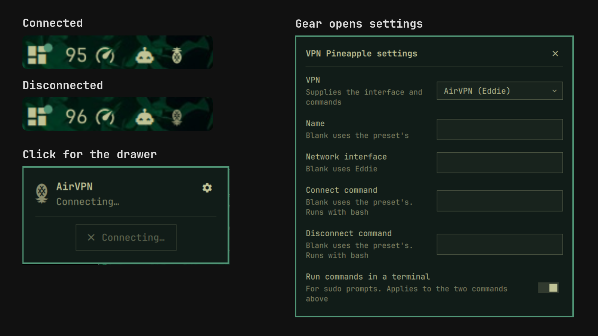

# VPN Pineapple



A bar widget for [Omarchy](https://omarchy.org) that shows your VPN status as a
pineapple: upright and in the bar's normal color while the tunnel is up, upside
down and muted while it is down. Hover for the status, click for a drawer with
the tunnel's address and a Connect / Disconnect button.

It works with any VPN that creates a network interface. Presets cover AirVPN
(Eddie), plain WireGuard and Mullvad. Anything else can use the Custom preset
with your own interface name and commands.

## Install

```sh
omarchy plugin add https://github.com/TaylorBurke/vpn-pineapple --enable
```

The widget is added to the right of the bar. Move it with
`omarchy bar move taylorburke.vpn-pineapple --section <section>`.

## Settings

Click the pineapple, then the gear in the drawer's top-right corner. Changes are
saved as you make them. You can also set them from a terminal:

```sh
omarchy bar set taylorburke.vpn-pineapple preset "WireGuard (wg-quick)"
omarchy bar set taylorburke.vpn-pineapple interface wg1
```

| Setting | Key | What it does |
| --- | --- | --- |
| VPN | `preset` | Preset that supplies the interface and the Connect / Disconnect commands |
| Name | `name` | Shown in the tooltip and drawer. Blank uses the preset's name |
| Network interface | `interface` | The pineapple is upright while this interface exists. Blank uses the preset's |
| Connect command | `connectCommand` | Replaces the preset's Connect action. Runs with bash |
| Disconnect command | `disconnectCommand` | Replaces the preset's Disconnect action. Runs with bash |
| Run custom commands in a terminal | `useTerminal` | Opens the two commands above in a terminal, so `sudo` can ask for a password |

### Presets

| Preset | Interface | Connect | Disconnect |
| --- | --- | --- | --- |
| AirVPN (Eddie) | `Eddie` | `eddie-cli --mode.type=wireguard --elevation=sudo --connect` in a terminal | Ctrl+C to Eddie (`pkill -INT`), which saves the remembered login |
| WireGuard (wg-quick) | `wg0` | `sudo wg-quick up <interface>` in a terminal | `sudo wg-quick down <interface>` in a terminal |
| Mullvad | `wg0-mullvad` | `mullvad connect` | `mullvad disconnect` |
| Custom | your setting | your setting | your setting |

The AirVPN preset needs `eddie-cli` from the AUR and a login saved once with
Eddie's `--remember` option. While Eddie is running but has not brought the
tunnel up yet, the drawer still offers Disconnect.

For WireGuard, set **Network interface** to the name of your config in
`/etc/wireguard/` (`wg1` for `wg1.conf`).

The AirVPN preset is the one in daily use. The WireGuard and Mullvad presets run
the standard commands for those tools but have not yet been tested against a
live tunnel. Reports are welcome.

### Custom examples

| VPN | Interface | Connect | Disconnect |
| --- | --- | --- | --- |
| OpenVPN via NetworkManager | `tun0` | `nmcli connection up my-vpn` | `nmcli connection down my-vpn` |

Turn off **Run custom commands in a terminal** for commands that need no
password, such as `nmcli`.

## What it does not do

VPN Pineapple is a status light, not a leak guard. An upright pineapple means
only that the VPN's network interface exists. The widget does not check that
your traffic, DNS or IPv6 actually go through the tunnel, and it does not block
anything when the tunnel drops. For that, turn on your VPN's own protection,
such as Eddie's Network Lock or Mullvad's lockdown mode, or set up a firewall
kill switch.

## How it works

Every two seconds the widget checks whether `/sys/class/net/<interface>` exists
and reads the interface's IPv4 address with `ip`. That is all it watches, so it
never needs root and works no matter how the tunnel was started. Commands run
only when you press Connect or Disconnect. The interface name is checked
against Linux's naming rules before use and passed to commands as an argument,
never spliced into a script.

When a command run in a terminal fails, the terminal stays open so you can read
the error.

## Uninstall

```sh
omarchy plugin remove taylorburke.vpn-pineapple
```

## License

[MIT](LICENSE)
